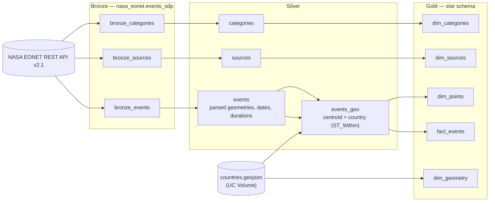

# NASA-EONET — Natural Events Medallion Data Pipeline

An end-to-end data engineering project that ingests [NASA's Earth Observatory
Natural Event Tracker (EONET)](https://eonet.gsfc.nasa.gov/) — wildfires, storms,
volcanoes, icebergs and other natural events — into a **medallion-architecture
pipeline** on Databricks, published to **Unity Catalog**.

The project has two builds of the same pipeline:

1. **Exploratory notebooks** (`01`–`05`) — the original interactive build, notebook by notebook.
2. **Lakeflow Spark Declarative Pipeline (SDP)** (`pipeline/`) — the productionized version:
   declarative, refreshable datasets with data-quality expectations, running on serverless compute.

---

## Architecture

The declarative pipeline refreshes every dataset on each update. EONET is a snapshot-style
open-access REST API (no key required), so the bronze layer materializes the latest snapshot
with ingestion metadata, and every downstream layer derives from it.



### Layer responsibilities

| Layer | Datasets | What happens |
| --- | --- | --- |
| Bronze | `bronze_events`, `bronze_categories`, `bronze_sources` | Fetch the latest API snapshot (events: last 365 days) with `ingestion_id` / `ingestion_timestamp` provenance. `geometries` are kept as a JSON string (the raw dicts mix types Spark cannot infer as a struct). |
| Silver | `categories`, `sources`, `events`, `events_geo` | Type casts and ingestion-column removal; parse `geometries` JSON into typed structs (`from_json`) and build `array<geometry>` with `st_geomfromgeojson`; extract `category_id` / `source_id` arrays, `min_date` / `max_date` / `event_duration`; compute each event's centroid (`avg_point`) and attribute a country via a spatial `ST_Within` join against a countries GeoJSON reference. |
| Gold | `dim_categories`, `dim_sources`, `dim_points`, `dim_geometry`, `fact_events` | Star schema: dimensions for categories, sources, distinct centroid points (surrogate `point_id` via `ST_AsText` dedup), and countries; `fact_events` joins events to `dim_points` with `ST_Equals` and drops heavy geometry payloads. |

### Data quality (SDP expectations)

* `bronze_events` / `fact_events`: **fail** on missing event id.
* `events`: warn if no geometry parses (`size(geometry) > 0`).
* `events_geo`: warn when a country cannot be attributed (legitimate for open-ocean events — ~2% of events).
* `categories` / `sources`: **drop** rows without id or title.

---

## Repository structure

```
NASA-EONET/
├── 00_config                 # shared config for the notebook build (API URL, table names)
├── 01_bronze_api_fetch       # notebook: fetch EONET API → bronze tables (append + mergeSchema)
├── 03_silver_clean&val       # notebook: cleaning, validation, geometry parsing, spatial enrichment
├── 04_gold                   # notebook: star schema (incl. spaCy hotwords on categories)
├── 05_visualizations         # notebook: analysis / charts
├── pipeline/                 # ← Lakeflow Spark Declarative Pipeline source (productionized)
│   ├── eonet_client.py       # shared REST client (BASE_URL, fetch_endpoint)
│   ├── bronze/              # bronze_categories.py, bronze_sources.py, bronze_events.py
│   ├── silver/              # categories.py, sources.py, events.py, events_geo.py (+ countries_ref view)
│   └── gold/                # dim_categories.py, dim_sources.py, dim_points.py, dim_geometry.py, fact_events.py
├── README.md
└── LICENSE
```

## Running the declarative pipeline

* **Pipeline**: *NASA-EONET Medallion Pipeline* (serverless, catalog `nasa_eonet`, schema `events_sdp`)
* **Source**: everything under `pipeline/` — one dataset per file, in dependency order.
* **Run**: open the pipeline in the Databricks Pipelines UI and click **Start** (or schedule it / attach it to a Lakeflow Job). Each update re-fetches the EONET snapshot and rebuilds all layers.
* **Verify**: the last full run processed **1,618 events** with a **98.1% country-match rate** (the unmatched ~2% are genuine open-ocean events such as Antarctic icebergs and mid-ocean cyclones).

### Notes & differences vs. the notebook build

* The SDP build parses `countries.geojson` with **pure Spark** (schema with `geometry` as a raw JSON string + `st_geomfromgeojson`) instead of GeoPandas — no Python dependency to install, and it works on serverless compute.
* `dim_geometry` now contains **all 258 countries** from the reference file (the notebook version derived it from events only).
* `dim_points` deduplicates geometries via `ST_AsText` (Spark cannot hash the GEOMETRY type).
* All geometries are normalized to **SRID 4326** (`ST_SetSRID`) so `ST_Within` / `ST_Equals` joins succeed.
* The spaCy `hotwords` enrichment from `04_gold` is not ported to the pipeline; add `spacy` to the pipeline environment to include it.

## Engineering gotchas discovered (EONET + Spark)

* EONET v2.1 `limit=0` returns **zero** events (not "no limit") — the client omits the parameter instead.
* `geometries` must be stored as a JSON string in bronze: the raw dicts mix `str` and `list` values.
* Every EONET v2.1 geometry observed is a `Point` with flat `[lon, lat]` coordinates.
* `size()` returns `-1` for NULL arrays; `aggregate()` needs `cast(0.0 as double)` to match a DOUBLE accumulator.
* Spark cannot hash or `DISTINCT` the GEOMETRY type — dedup on `ST_AsText` instead.

## Setup

1. A Databricks workspace with Unity Catalog (catalog `nasa_eonet`; schemas `events`, `events_silver`, `events_gold`, `events_sdp`).
2. Countries GeoJSON at `/Volumes/nasa_eonet/events_silver/countriesgeojson/countries.geojson` (used for country attribution; sourced from a Natural-Earth-based country boundaries file).
3. No API key needed — EONET is open access.

## License

See [LICENSE](LICENSE).
